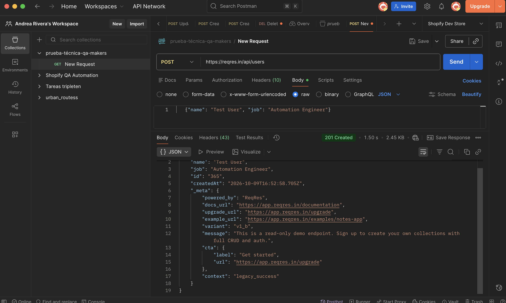
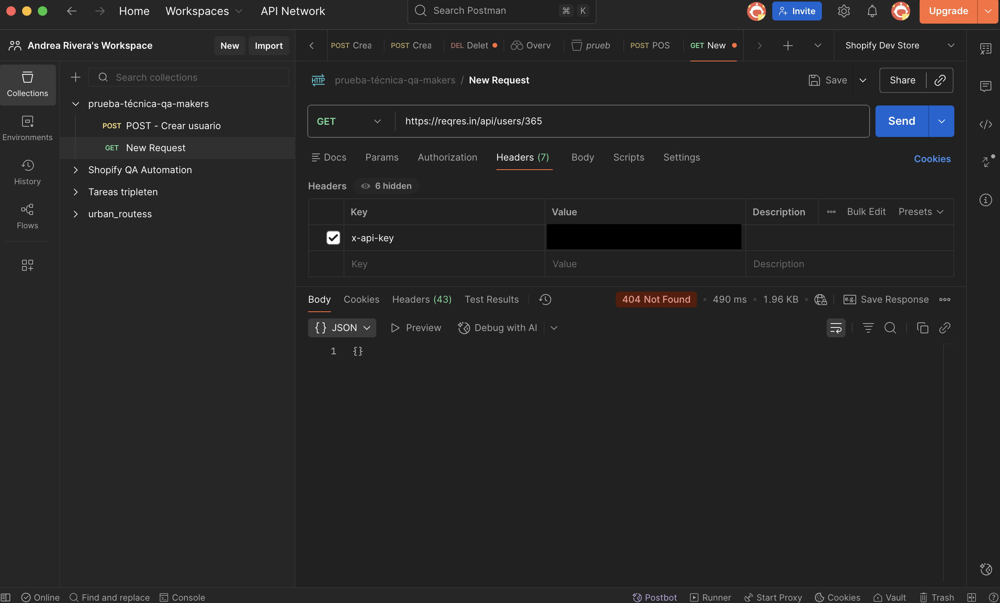
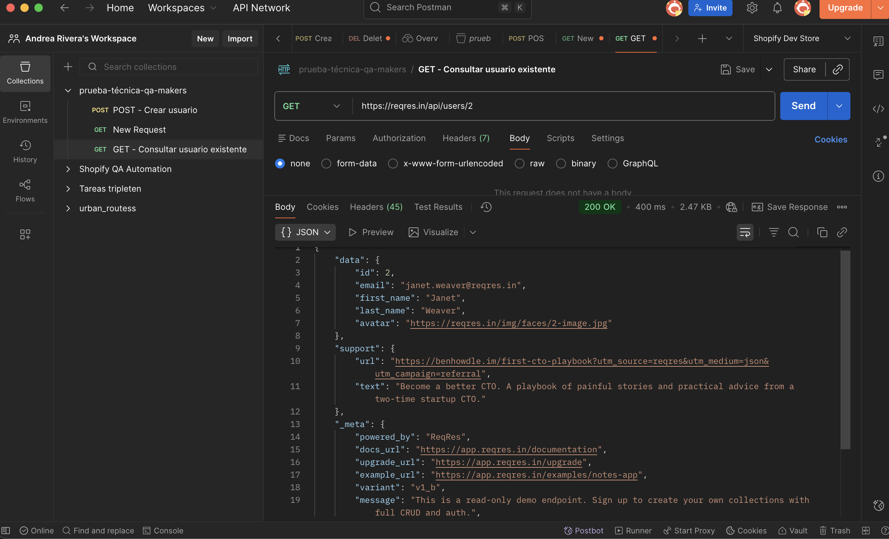
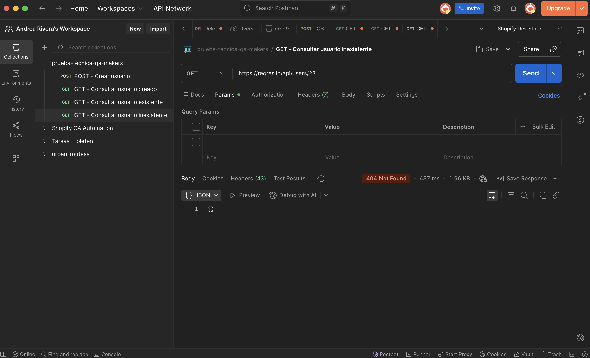

# Evidencias de pruebas – Módulo API

**Prueba técnica QA Full Stack – Makers Solutions**
Andrea Rivera Amador · Octubre 2026

---

## 1. Objetivo

Validar el flujo de creación y consulta de usuarios de la API **reqres.in**: crear un usuario con `POST`, extraer su ID y consultarlo con `GET`, verificando códigos de estado y datos de la respuesta.

## 2. Ambiente y herramientas

| Elemento | Detalle |
|---|---|
| **API** | https://reqres.in/api |
| **Herramientas** | Postman · Python (pytest + requests) |
| **Autenticación** | Header `x-api-key` (clave gratuita de reqres.in) |
| **Fecha de ejecución** | 09/10/2026 |

---

## 3. Casos de prueba

### CP-API-01 – Crear usuario (POST)

| Campo | Detalle |
|---|---|
| **Request** | `POST https://reqres.in/api/users` |
| **Headers** | `x-api-key`, `Content-Type: application/json` |
| **Body** | `{"name": "Test User", "job": "Automation Engineer"}` |
| **Resultado esperado** | `201 Created`, con `name`, `job` e `id` en la respuesta |
| **Resultado obtenido** | `201 Created`. Devuelve `name`, `job`, `id: "365"` y `createdAt` |
| **Estado** | ✅ Pasó |

**Observaciones:** el `id` se devuelve como texto (`"365"`) y no como número. La respuesta indica que es un endpoint de demostración de solo lectura.

---

### CP-API-02 – Consultar usuario creado (GET)

| Campo | Detalle |
|---|---|
| **Request** | `GET https://reqres.in/api/users/365` |
| **Headers** | `x-api-key` |
| **Resultado esperado** | `200 OK`, con `name: "Test User"` y `job: "Automation Engineer"` |
| **Resultado obtenido** | `404 Not Found`, body vacío `{}` |
| **Estado** | ❌ Falló (limitación del entorno) |

**Observaciones:** reqres.in es una API de prueba (mock). El `POST` simula la creación, pero **no guarda el usuario**, por lo que el `GET` posterior no lo encuentra. Ver hallazgo **H-01**.

---

### CP-API-03 – Consultar usuario existente (GET)

| Campo | Detalle |
|---|---|
| **Request** | `GET https://reqres.in/api/users/2` |
| **Headers** | `x-api-key` |
| **Resultado esperado** | `200 OK`, con los datos del usuario (`id`, `email`, `first_name`, `last_name`, `avatar`) |
| **Resultado obtenido** | `200 OK`. Devuelve el usuario `id: 2` (Janet Weaver) con todos sus campos |
| **Estado** | ✅ Pasó |

**Observaciones:** este caso confirma que el endpoint `GET /users/{id}` funciona correctamente con usuarios existentes. Por lo tanto, el `404` del CP-API-02 se debe a que el usuario creado con `POST` no se guarda, y no a una falla del `GET`. Además, aquí el `id` se devuelve como **número** (`2`), mientras que en el `POST` se devuelve como **texto** (`"365"`): hay una inconsistencia en el tipo de dato entre endpoints (ver **H-03**).

---

### CP-API-04 – Consultar usuario inexistente (GET) · Caso negativo

| Campo | Detalle |
|---|---|
| **Request** | `GET https://reqres.in/api/users/23` |
| **Headers** | `x-api-key` |
| **Resultado esperado** | `404 Not Found`, ya que el usuario no existe |
| **Resultado obtenido** | `404 Not Found`, body vacío `{}` |
| **Estado** | ✅ Pasó |

**Observaciones:** la API responde con el código correcto, pero el body llega vacío, sin un mensaje que explique el error (ver **H-04**).

---

## 4. Hallazgos

### H-01 – El usuario creado con POST no se puede consultar con GET

| Campo | Detalle |
|---|---|
| **Severidad** | Media |
| **Tipo** | Limitación del entorno de pruebas |
| **Descripción** | El `POST /users` responde `201` con un `id` nuevo, pero el `GET /users/{id}` devuelve `404`. La propia API indica que es un endpoint de demostración de solo lectura. |
| **Impacto** | No es posible validar de punta a punta que los datos enviados se guarden correctamente. |
| **Recomendación** | En un ambiente real, validar contra una API con persistencia o usar las colecciones con almacenamiento de reqres.in. |

### H-02 – Cambio en la autenticación de la API

reqres.in ahora exige el header `x-api-key` en todas las solicitudes. Se gestionó con una clave gratuita, que en la automatización se lee desde una **variable de entorno** para no exponerla en el repositorio.

### H-03 – Inconsistencia en el tipo de dato del `id`

| Campo | Detalle |
|---|---|
| **Severidad** | Baja |
| **Tipo** | Inconsistencia de contrato de la API |
| **Descripción** | `POST /users` devuelve el `id` como texto (`"365"`), mientras que `GET /users/{id}` lo devuelve como número (`2`). |
| **Impacto** | Los clientes que consuman la API podrían fallar al comparar o procesar el `id` si esperan un tipo de dato específico. |
| **Recomendación** | Unificar el tipo de dato del `id` en todos los endpoints según el contrato definido. |

### H-04 – Respuesta 404 sin mensaje de error

| Campo | Detalle |
|---|---|
| **Severidad** | Baja |
| **Tipo** | Mejora en el manejo de errores |
| **Descripción** | Al consultar un usuario inexistente, la API devuelve `404` con el body vacío `{}`. |
| **Impacto** | Quien consume la API no recibe información adicional para entender o mostrar el error al usuario final. |
| **Recomendación** | Incluir un mensaje descriptivo, por ejemplo `{"error": "User not found"}`. |

---

## 5. Resumen de resultados

| ID | Caso | Esperado | Obtenido | Estado |
|---|---|---|---|---|
| CP-API-01 | Crear usuario | 201 | 201 | ✅ |
| CP-API-02 | Consultar usuario creado | 200 | 404 | ❌ |
| CP-API-03 | Consultar usuario existente | 200 | 200 | ✅ |
| CP-API-04 | Consultar usuario inexistente | 404 | 404 | ✅ |